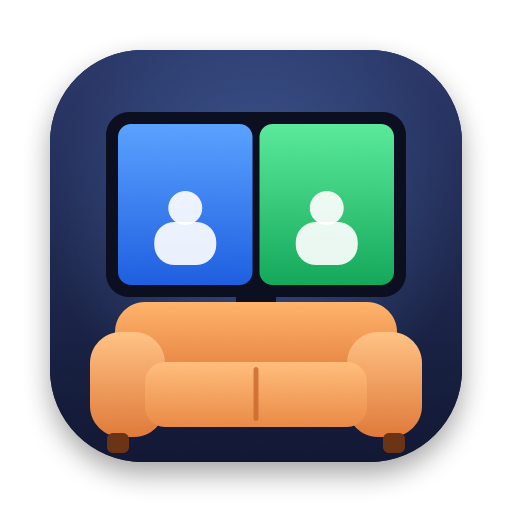

<p align="center"></p>

# SofaSplit

**Split-screen co-op on one Mac** for games that only have online or LAN multiplayer.

SofaSplit starts one copy of a game per player, gives every copy its own gamepad, keeps all of them running
side by side, and tiles their windows across your screen. For Steam games that use Steam lobbies, every copy
also gets its own Steam identity, so the copies can join each other, all on one Mac and one Steam account.

Inspired by [Nucleus Co-op](https://github.com/SplitScreen-Me/splitscreenme-nucleus) for Windows; SofaSplit is a
separate, native macOS project.

## Install

1. Download the latest **SofaSplit-….zip** from [Releases](https://github.com/ewencedr/SofaSplit/releases) and double-click it.
2. Drag **SofaSplit.app** into your **Applications** folder.
3. Open it. The first time, macOS says it can't verify the app, because SofaSplit isn't signed with a paid
   Apple Developer certificate. Click **Done**, then go to **System Settings → Privacy & Security**, scroll down
   to *"SofaSplit" was blocked…* and click **Open Anyway**. This is only needed once.

Requires macOS 14 or later, on Apple Silicon or Intel. No other permissions or downloads are needed.

## Play

1. **Connect the controllers** (Bluetooth or USB). PlayStation, Xbox, Switch Pro and most other gamepads work. A
   controller can switch between cable and Bluetooth at any time and stays the same player.
2. **Add a game:** click **Add Game → From Steam Library…** and pick it, or **Choose App…** for games from
   elsewhere. SofaSplit checks the game and tells you how likely it is to work.
3. **Pick a layout** (side by side, top/bottom, 3, 4, … players). For games that already have local co-op on one
   screen (like Monster Prom), pick **Shared screen**: one window that sees every controller, still with
   SofaSplit's controller fixes.
4. **Press a button on each controller.** Each one joins the next free slot.
5. Click **Play**. The windows open one after another. Each controller only controls its own window, and for
   Steam Input games its light shows the player colour: blue, green, yellow, pink.
6. **Connect the players inside the game**, the same way you would online: host a game in Player 1's window,
   then join it from the others (with the game's lobby code, its server list, or `127.0.0.1` for direct-IP games).

The keyboard and mouse work in whichever window you click.

## Which games work?

SofaSplit can't add multiplayer to single-player games: the game needs online or LAN multiplayer. When you add a
game, SofaSplit shows one of these:

| Shown | Meaning |
|---|---|
| ✅ **Likely works** | The game uses Steam lobbies and Steam messaging, which SofaSplit emulates between the windows |
| 🟠 **Might work** | Works if the game has LAN or direct-IP multiplayer, or SofaSplit couldn't tell for sure. Try it |
| ❌ **Probably won't work** | The game's multiplayer depends on something SofaSplit can't emulate yet (see the reason shown) |

Not supported: Mac App Store games (they're encrypted) and games with anti-cheat.

### Tested games

| Game | Status | Notes |
|---|---|---|
| Escape Simulator 2 | ✅ Works | Host in Player 1, join with the lobby code. Has its own optimized settings |
| Human Fall Flat | ✅ Works | Player 1: Play → Online → Host. Others: Play → Online, pick Player 1's game. PS4 controllers on Bluetooth work too, which the game can't read on its own on current macOS |
| Monster Prom | ✅ Works | Local co-op: use the **Shared screen** layout. Makes PS4 controllers work (on Bluetooth or cable), which the game doesn't support on its own on current macOS |
| Golf With Your Friends | ❌ Doesn't work | Its online service (Photon) checks the Steam account and refuses the same account twice |

Tried a game? Please [report it](https://github.com/ewencedr/SofaSplit/issues/new?template=game-report.md),
whether it worked or not, so the list grows.

## When something doesn't work

- **Open Game settings** below the layout. The detected options can be switched on or off:
  - *Steam multiplayer between windows*: turn on if the windows can't find or join each other's Steam lobby.
  - *Route Steam Input controllers*: turn on if every controller moves every window.
  - *Separate saves for each player*: turn off if the game can't find its save or settings.
  - *Keep every window running* and *Borderless windows*: turn off if a game misbehaves with them.
- **A window stays black:** wait a minute. macOS checks every new copy of a game the first time it starts (Intel
  games also get translated by Rosetta the first time).
- **A controller does nothing in one window:** make sure it's switched on before you press Play. If a controller
  switched itself off, wake it with its PS / Home button: it reconnects to the same window.
- **Still stuck?** Click **Copy Diagnostics** and paste it into a [bug report](https://github.com/ewencedr/SofaSplit/issues/new?template=bug.md).

---

## For developers

### Build from source

Needs the Xcode Command Line Tools (`xcode-select --install`).

```sh
git clone https://github.com/ewencedr/SofaSplit.git && cd SofaSplit
./scripts/build.sh            # -> build/SofaSplit.app (+ build/TestGame.app, a diagnostic window)
swift test
```

`UNIVERSAL=1 ./scripts/build.sh` builds for Apple Silicon and Intel (needs full Xcode). With only the Command
Line Tools, `swift test` sometimes fails with "plugin for module 'TestingMacros' not found"; run it again.
Releases are built by GitHub Actions: pushing a tag like `v0.2.0` publishes `SofaSplit-0.2.0.zip`.

### How it works

| Problem | What SofaSplit does |
|---|---|
| A game only runs once | Each player gets an APFS clone of the `.app` (no extra disk space) with its own bundle ID, launched directly |
| Every window reacts to every controller | `libSofaSplitHook.dylib`, injected with `DYLD_INSERT_LIBRARIES`, hides all but the assigned pad from IOKit HID, GameController and Steam Input. Pads are recognised by their Bluetooth address, so cable ↔ Bluetooth switches keep the player |
| Older games ignore PS4 controllers on Bluetooth | macOS puts a Bluetooth DUALSHOCK 4 into its extended report mode, which games reading HID elements (Unity's old input) can't parse. The hook decodes report 0x11 and feeds them normal button and axis values |
| Games hard-code the old Mac Xbox 360 button numbers | With `Hook.ControllerLayout = "xbox360"`, a DUALSHOCK 4 is presented with that numbering (A = button 16 …): 20 of its constant padding elements stand in as buttons |
| Background windows pause | The hook keeps the app "active", hides focus-loss notifications and the engine's own resign handlers (Unity stops reading controllers otherwise), enables background controller events and disables App Nap |
| Windows need tiling | The hook places each window in its slot, borderless, and blocks native fullscreen (Accessibility API as fallback) |
| Copies on one Steam account can't join each other | The hook gives each copy its own Steam ID (from the unused "web instance" range) and runs Steam lobbies, the lobby list, `ISteamNetworkingMessages` and the older `ISteamNetworking` P2P API locally between the copies over Unix sockets, for both current and older Steamworks.NET. Login, ownership, DLC, achievements and cloud saves still go through the real Steam client |
| Every game is different | The analyzer (`GameAnalyzer.swift`) detects the engine, the Steam app ID and which Steam APIs the game's code calls, and sets options; JavaScript handlers cover the rest |

### Handlers

A handler is a JavaScript file with a game's options and an optional `Game.Play(Context)` function that runs
before each copy starts (to edit config files, set arguments, and so on). The handlers in `Handlers/` ship inside
the app. Your own go in `~/Library/Application Support/SofaSplit/handlers/`, and a file there with the same name
replaces the built-in one; the app's **Edit…** button creates that copy for you. `Handlers/_Template.js`
documents every option and helper, and `Handlers/EscapeSimulator2.js` is a full example. Contributions of
handlers for more games are very welcome.

### CLI

```sh
SS=/Applications/SofaSplit.app/Contents/MacOS/sofasplit
$SS steam-games                 # installed Steam games with a Mac version
$SS analyze /path/to/Game.app   # compatibility check and the settings it would use
$SS controllers                 # connected gamepads
$SS play /path/to/Game.app --players 2 --layout sideBySide
```

Data lives in `~/Library/Application Support/SofaSplit/`: the library, logs, and `content/<Game>/Instance<N>/`
with each player's copy, `output.log` and `hook.log`.

## Legal

- SofaSplit is not affiliated with or endorsed by Valve, SplitScreen.Me / Nucleus Co-op, Sony, Microsoft,
  Nintendo, or any game developer. Trademarks belong to their owners.
- The repository contains no game files, no Steamworks SDK files and no code from Nucleus Co-op. The Steam
  structures it needs for interoperability are declared from scratch.
- SofaSplit doesn't bypass DRM, ownership checks or purchases: you need to own the game and be signed in to
  Steam. Every copy runs locally on your own Mac.
- Injecting into games and running modified copies may conflict with some games' terms of use. **Don't use it
  with games that have anti-cheat** (Easy Anti-Cheat, BattlEye, VAC-secured servers): that can get an account banned.
- Use at your own risk. This is not legal advice.

## License

[MIT](LICENSE)
